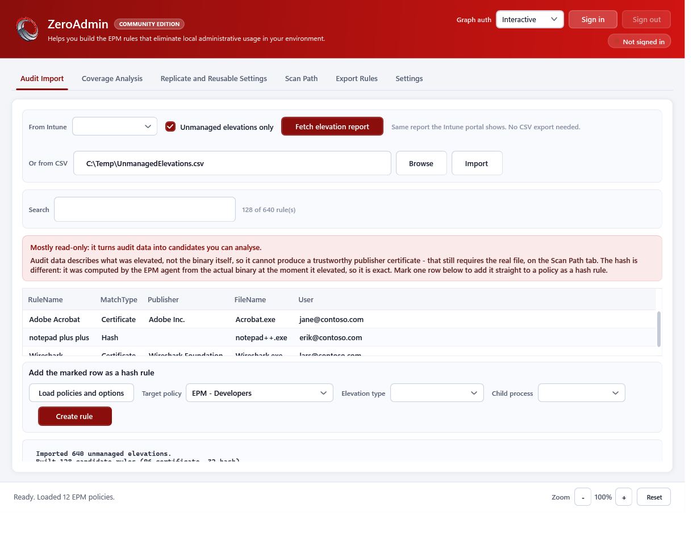
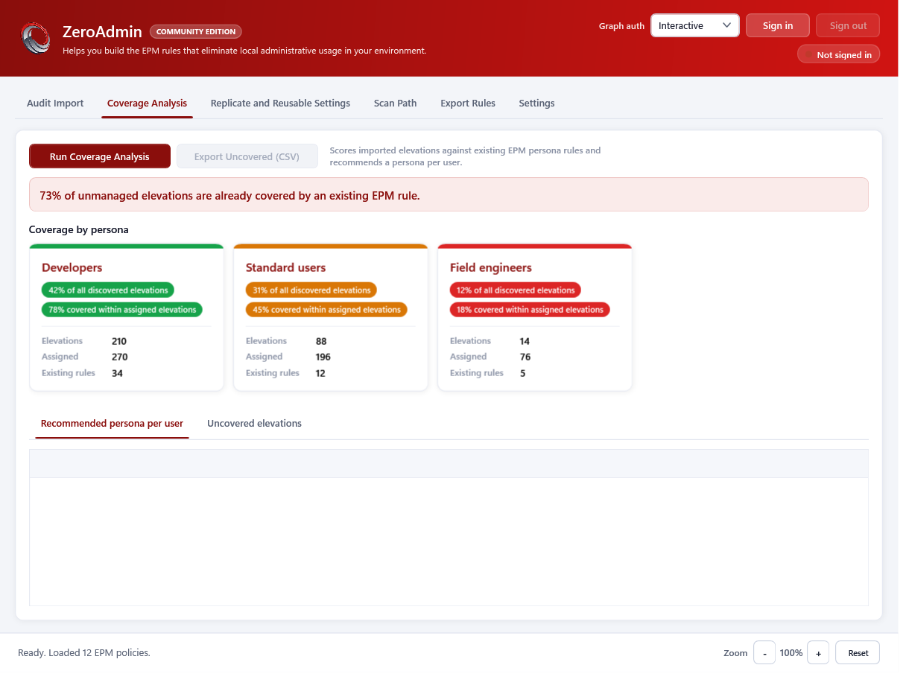
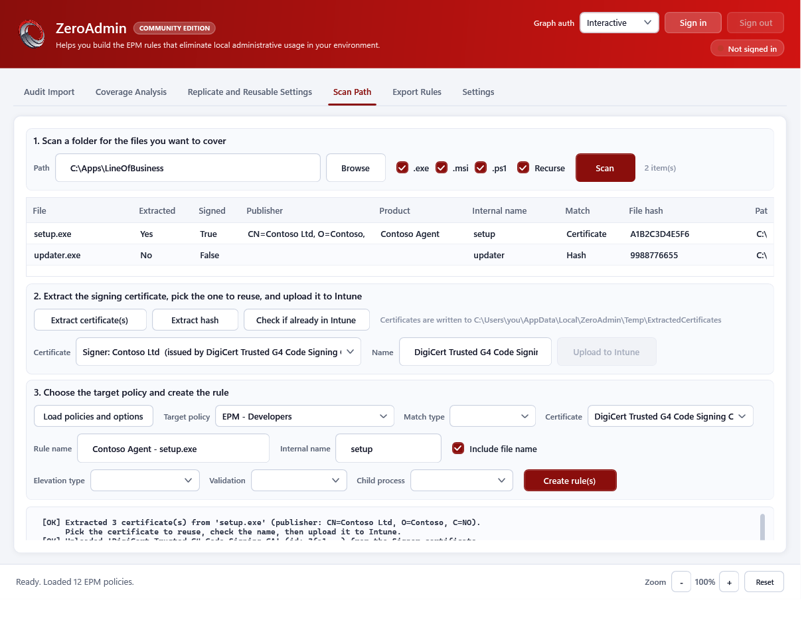
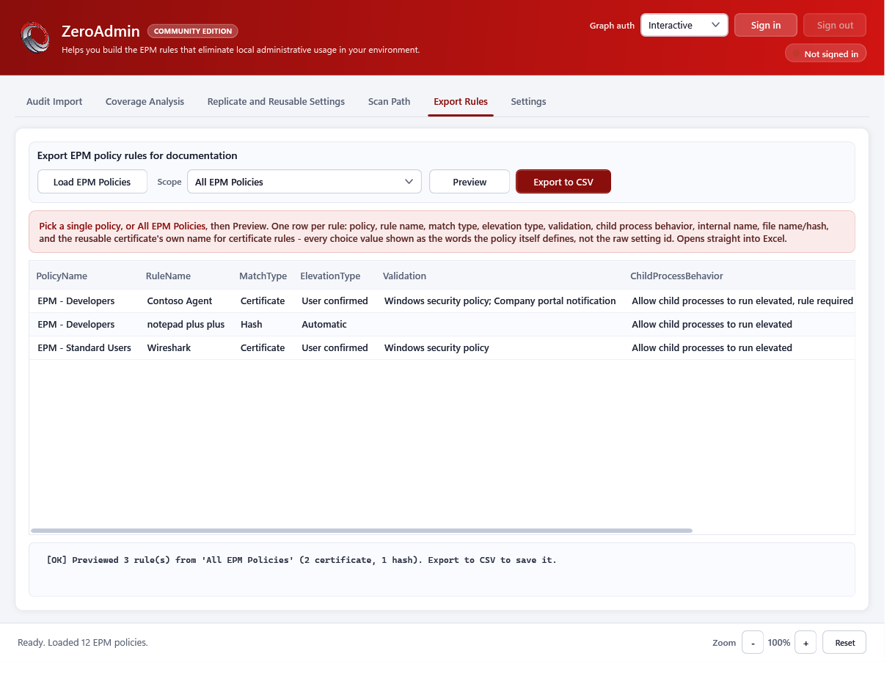
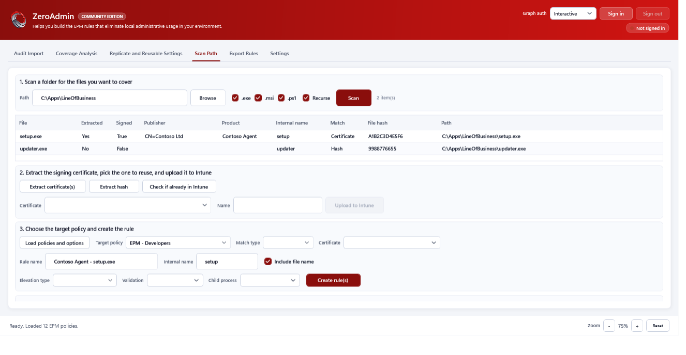

# ZeroAdmin

[](#requirements) [](#requirements) [](#license)

## Overview
ZeroAdmin helps you build the Microsoft Intune Endpoint Privilege Management (EPM) rules that eliminate local administrative usage in your environment. It is a WPF GUI (plus a headless reporting mode) built around one principle: a **certificate** rule is only ever created from the real binary, because a publisher *name* is easy to spoof but a certificate is not; a **hash** rule can be created straight from an audit row, because that hash was computed by the EPM agent from the real file at the moment it elevated - so it is exact, not a guess.

Everything else in the tool exists to get you to one of those two write paths with confidence: read what your users are actually elevating (from the live Intune report or a CSV export), see how much of it existing persona rules already cover, and build the rest - either from a real file on disk or, for a hash match, directly from the audit data.

## Features
- **Audit Import** - reads the EPM elevation report straight out of the tenant (the same Graph request the Intune portal makes, no CSV export needed) or imports an "unmanaged elevations" CSV; mark one row and add it straight to a policy as a hash rule
- **Coverage Analysis** - scores imported elevations against existing EPM persona rules, breaks coverage down per persona with a green/amber/red confidence score, recommends a persona per user, and lists everything not covered yet
- **Scan Path** - the only place a certificate rule is built: scan a folder for `.exe`/`.msi`/`.ps1`, extract the signing certificate (whole chain, pick signer/intermediate/root), check it against what is already in the tenant by thumbprint, upload it as a reusable setting, then create the rule
- **Replicate and Reusable Settings** - copy an existing rule from one EPM policy to another, and find every rule and policy that references a given reusable certificate setting
- **Export Rules** - pick one policy or all of them, preview every rule flattened to one row with every choice value resolved to the words the policy itself defines (not the raw setting-catalog id), export to CSV for documentation in Excel
- **Headless reporting mode** - `-NoGui` prints a duplicate/best-practice report from a CSV without touching the tenant, or replicates a rule with `-Apply`
- **Fits small and high-DPI screens** - the window opens sized to whatever screen it is actually on, renders at native per-monitor DPI regardless of the host that launched it, and a zoom control (`Ctrl` + mouse wheel, `Ctrl+Plus`/`Ctrl+Minus`/`Ctrl+0`, or the footer buttons) scales the whole UI up or down and remembers the level you leave it at
- Reads live from each policy's own setting definitions for elevation type, validation, child process behavior and certificate type - nothing is hardcoded, so it stays correct across tenants and template versions

## Requirements
- Windows PowerShell 5.1 or PowerShell 7+, on Windows (WPF GUI)
- [Microsoft.Graph.Authentication](https://www.powershellgallery.com/packages/Microsoft.Graph.Authentication) module (the script offers to install it for you on first run if missing)
- A Microsoft Entra account that can consent to the `DeviceManagementConfiguration.ReadWrite.All` delegated Graph scope for your tenant
- For certificate extraction on the Scan Path tab: the `EpmTools` module that ships with the Microsoft EPM Agent (`%ProgramFiles%\Microsoft EPM Agent\EpmTools`) - everything else in the tool works without it

## Install
- Clone or download the repository
- Unblock the script if needed:
    ```powershell
    Unblock-File .\ZeroAdmin.ps1
    ```
- Ensure execution policy allows running local scripts:
    ```powershell
    Set-ExecutionPolicy -Scope CurrentUser RemoteSigned
    ```

## Quick Start

**Launch the GUI** (the default when no parameters are given):
```powershell
.\ZeroAdmin.ps1
```

**Or run a headless report from a CSV**, without writing anything to Intune:
```powershell
.\ZeroAdmin.ps1 -CsvPath "C:\temp\UnmanagedElevations.csv" -NoGui
```

> **Note:**
> The GUI needs an STA thread. If you see "The calling thread must be STA" when dot-sourcing the script from a console that defaults to MTA (a standalone `pwsh` 7 session, for example), the script detects this and relaunches itself in a fresh STA process automatically - you do not need to do anything, but if you prefer to start it that way yourself: `pwsh -STA -File .\ZeroAdmin.ps1`.

## Parameters
- `CsvPath` - audit CSV to import in headless report mode
- `SourcePolicyId` / `TargetPolicyId` / `RuleName` - headless rule replication (needs `-Apply` to actually write)
- `ReusableSettingId` - headless reusable-setting usage lookup
- `ColumnMap` - hashtable overriding auto-detected CSV column names (`FilePath`, `FileName`, `FileHash`, `Publisher`, `Product`, `Description`, `User`, `Device`, `ElevationType`)
- `MatchType` - `Auto` (default), `Certificate`, or `Hash`, for the headless CSV report
- `OutputPath` - where a headless report or export is written; defaults to a timestamped file in `reports\`
- `Apply` - actually replicate a rule in headless mode; without it, the replication is previewed only
- `NoGui` - run headless instead of launching the GUI
- `GraphAuthMode` - `Interactive` (default) or `DeviceCode`, for FIDO2/security-key sign-in
- `LogPath` - override the debug log location (defaults to `reports\ZeroAdmin.debug.log` next to the script, falling back to `%LOCALAPPDATA%\ZeroAdmin\reports` if that folder is not writable)

## Example Usage

**Audit Import** - read live from Intune or a CSV, then either analyse coverage or push a hash rule straight from a marked row:



**Coverage Analysis** - see at a glance how much of what your users elevate is already covered, broken down per persona:



**Scan Path** - the only place a certificate rule gets built, in three steps against the real file:



**Export Rules** - flatten a policy (or every policy) to one row per rule, ready for Excel:



**Small screens** - the same Scan Path tab, in the same 1326x688 window (a 1366x768 laptop's work area once the taskbar is accounted for) that clips step 3 entirely at 100%, with the zoom control at 75%:



**Headless report** (`-CsvPath ... -NoGui`), real output against a two-row demo CSV:
```
Rule: Contoso Agent - setup.exe
  Match type   : Certificate
  File name    : setup.exe
  Publisher    : Contoso Ltd
  Duplicate    : none found
  [Info] No best-practice concerns detected for this rule.
Rule: notepad++.exe
  Match type   : Hash
  File name    : notepad++.exe
  Publisher    :
  Duplicate    : none found
  [Info] File is unsigned, so a hash match is appropriate. The rule will need updating whenever the binary changes.
Exported 2 candidate rule(s) to '...\report.json'.
```

## Output
- GUI status bar and per-tab console panes with `[OK]`/`[WARN]`/`[INFO]` progress for every operation
- CSV exports: policy rules (Export Rules tab), uncovered elevations (Coverage Analysis tab)
- JSON candidate export from the headless report mode
- A rolling diagnostic log (every Graph request, response counts, and full error responses) at `reports\ZeroAdmin.debug.log`, so an issue can be reproduced and shared

## Tips and Troubleshooting
- Sign in once per session from the header - the token is kept until the window closes; switching tenants clears every cached policy, rule and reusable-setting list so nothing from the previous tenant stays selectable
- If `EpmTools` is not available, Scan Path still scans and can build hash rules; only certificate extraction needs it
- A "Unable to locate the elevation rules collection" error means the signed-in account cannot read that policy's settings - check the `DeviceManagementConfiguration.ReadWrite.All` scope was consented
- Upgrading from the earlier `Build-EpmRules` naming: your saved temp-working-directory preference is migrated automatically on first run, from `%LOCALAPPDATA%\Build-EpmRules` to `%LOCALAPPDATA%\ZeroAdmin`
- Everything Scan Path reads (publisher, hash, product) comes from Authenticode and the file's own version resource - scanning never writes anything; certificate extraction is a separate, explicit step
- On a small screen, zoom out first (`Ctrl+Minus` or the footer `-` button) rather than fighting the window - the layout does not scroll on purpose, so a tab that overflows the window gets clipped instead; zooming out is what makes it fit

## Notes
- File: ZeroAdmin.ps1
- Author: Mattias Melkersen
- Version: 7.2 (Community Edition)

## Contributing
- Fork, create a feature branch, submit a PR

## Learn More
- [Endpoint Privilege Management overview](https://learn.microsoft.com/mem/intune/protect/epm-overview)
- [Microsoft Graph: deviceManagementConfigurationPolicy](https://learn.microsoft.com/graph/api/resources/intune-deviceconfigv2-devicemanagementconfigurationpolicy)
- [Microsoft Graph: deviceManagementReusablePolicySetting](https://learn.microsoft.com/graph/api/resources/intune-shared-devicemanagementreusablepolicysetting)
- Open issues for bugs and enhancements

## License
MIT License

Copyright (c) 2026 Mattias Melkersen

Permission is hereby granted, free of charge, to any person obtaining a copy
of this software and associated documentation files (the “Software”), to deal
in the Software without restriction, including without limitation the rights
to use, copy, modify, merge, publish, distribute, sublicense, and/or sell
copies of the Software, and to permit persons to whom the Software is
furnished to do so, subject to the following conditions:

The above copyright notice and this permission notice shall be included in
all copies or substantial portions of the Software.

THE SOFTWARE IS PROVIDED “AS IS”, WITHOUT WARRANTY OF ANY KIND, EXPRESS OR
IMPLIED, INCLUDING BUT NOT LIMITED TO THE WARRANTIES OF MERCHANTABILITY,
FITNESS FOR A PARTICULAR PURPOSE AND NONINFRINGEMENT. IN NO EVENT SHALL THE
AUTHORS OR COPYRIGHT HOLDERS BE LIABLE FOR ANY CLAIM, DAMAGES OR OTHER
LIABILITY, WHETHER IN AN ACTION OF CONTRACT, TORT OR OTHERWISE, ARISING FROM,
OUT OF OR IN CONNECTION WITH THE SOFTWARE OR THE USE OR OTHER DEALINGS IN
THE SOFTWARE.
